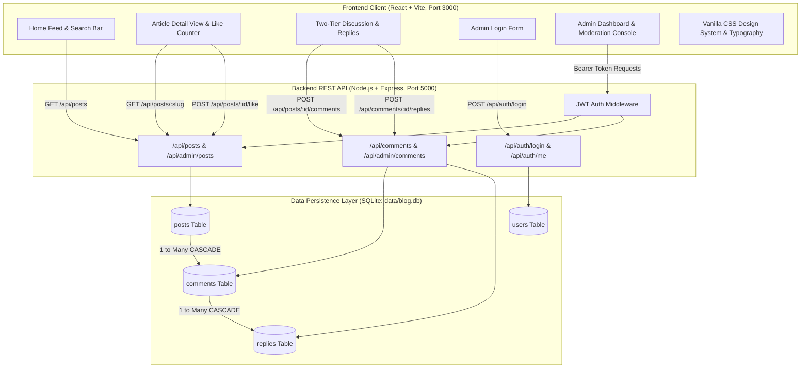

# Full-Stack Blog Application — Internship Project Report

**Project Title:** CHRONICLE — Modern Editorial Publishing & Discussion Platform  
**Document Type:** Final Project Submission Report & Technical Documentation  
**Prepared For:** Internship Project Evaluation  
**Status:** Completed & Production-Ready  

---

## 1. Executive Summary

This project delivers a responsive Full-Stack Blog Application engineered to fulfill the requirements of the internship assignment. 

The application implements a centralized editorial lifecycle where an **Administrator** holds full control over article drafting, publishing, archiving, and discussion moderation. Concurrently, **Public Visitors** are provided with a reading experience equipped with real-time keyword search, topical filtering, appreciation likes, and two-tier threaded discussions with single-level replies—all without account registration friction.

The project emphasizes software design principles: separation of concerns, strict relational integrity via SQLite foreign keys, client- and server-side validation, JWT authentication, and a custom Vanilla CSS design system.

---

## 2. System Architecture & Component Diagram



---

## 3. Requirements Traceability Matrix

| Requirement from Assignment | Implementation Detail | Status |
| :--- | :--- | :---: |
| **Role Distinction** | Dedicated Administrator role vs unauthenticated guest readers. | **Complete** |
| **Admin Authentication** | Secure login interface with bcrypt password hashing and JWT token verification. | **Complete** |
| **Blog Creation & Editing** | Form supporting Title, Body, Category, Tags, Author, Cover Image URL, and Status. | **Complete** |
| **Draft & Publish Lifecycle** | Distinct `Draft` and `Published` states; draft posts remain hidden from public view. | **Complete** |
| **Soft Delete / Archiving** | Deleting a post sets its state to `Archived`, preserving comments and metrics in the dashboard. | **Complete** |
| **Public Reading Experience** | Continuous scrollable feed displaying articles in reverse-chronological order. | **Complete** |
| **Search & Filtering (Optional)** | Real-time keyword search across titles and content, plus category filter pills. | **Complete** |
| **Interaction Count Badges** | Every article card showcases live badges for Likes and Comments/Replies. | **Complete** |
| **Appreciation Like Counter** | Dedicated "Like" button with live counter updates and pulse micro-animation. | **Complete** |
| **Comments on Posts** | Top-level comment submission with mandatory name and content validation. | **Complete** |
| **Single-Level Threaded Replies** | Inline replies linked directly to parent comments (no nested replies to replies). | **Complete** |
| **Context-Preserving Moderation** | Deleting a parent comment that has replies replaces it with a tombstone notice. | **Complete** |
| **Admin Content Moderation** | Admin can edit comment/reply text or delete any discussion entry platform-wide. | **Complete** |

---

## 4. Database Schema Design (SQLite)

### Relational Entity Model
```
┌─────────────────────────┐
│          users          │
├─────────────────────────┤
│ id (PK, INTEGER)        │
│ username (UNIQUE, TEXT) │
│ password_hash (TEXT)    │
│ created_at (DATETIME)   │
└─────────────────────────┘

┌───────────────────────────────────────┐
│                 posts                 │
├───────────────────────────────────────┤
│ id (PK, INTEGER)                      │
│ title (TEXT)                          │
│ slug (UNIQUE, TEXT)                   │
│ excerpt (TEXT)                        │
│ content (TEXT)                        │
│ author (TEXT)                         │
│ category (TEXT)                       │
│ tags (TEXT)                           │
│ cover_image (TEXT)                    │
│ status ('draft'|'published'|'archive')│
│ likes_count (INTEGER)                 │
│ published_at (DATETIME)               │
│ created_at (DATETIME)                 │
│ updated_at (DATETIME)                 │
└──────────────────┬────────────────────┘
                   │ 1
                   │
                   │ * (ON DELETE CASCADE)
┌──────────────────▼────────────────────┐
│               comments                │
├───────────────────────────────────────┤
│ id (PK, INTEGER)                      │
│ post_id (FK -> posts.id)              │
│ author_name (TEXT)                    │
│ content (TEXT)                        │
│ is_removed (INTEGER 0|1)              │
│ created_at (DATETIME)                 │
│ updated_at (DATETIME)                 │
└──────────────────┬────────────────────┘
                   │ 1
                   │
                   │ * (ON DELETE CASCADE)
┌──────────────────▼────────────────────┐
│                replies                │
├───────────────────────────────────────┤
│ id (PK, INTEGER)                      │
│ comment_id (FK -> comments.id)        │
│ post_id (FK -> posts.id)              │
│ author_name (TEXT)                    │
│ content (TEXT)                        │
│ created_at (DATETIME)                 │
│ updated_at (DATETIME)                 │
└───────────────────────────────────────┘
```

---

## 5. REST API Specification

### Public Endpoints

| Method | Endpoint | Description | Request Payload | Response |
| :--- | :--- | :--- | :--- | :--- |
| `GET` | `/api/posts` | Retrieve published posts with search and category filtering | Query: `?search=&category=` | `Array<Post>` with `comments_count` |
| `GET` | `/api/posts/:slug` | Retrieve single article details | Path: `:slug` | `Post` object |
| `POST`| `/api/posts/:id/like` | Increment like counter | Path: `:id` | `{ likes_count }` |
| `GET` | `/api/categories` | Retrieve list of categories with post counts | None | `Array<{ category, count }>` |
| `GET` | `/api/posts/:postId/comments` | Retrieve threaded comments and replies | Path: `:postId` | `Array<Comment>` with nested `replies` |
| `POST`| `/api/posts/:postId/comments` | Submit new top-level comment | `{ author_name, content }` | `{ message, comment }` |
| `POST`| `/api/comments/:commentId/replies` | Submit single-level reply | `{ author_name, content }` | `{ message, reply }` |

### Administrative Endpoints (Requires `Authorization: Bearer <token>`)

| Method | Endpoint | Description | Request Payload | Response |
| :--- | :--- | :--- | :--- | :--- |
| `POST` | `/api/auth/register` | Register new Author account | `{ username, email, password }` | `{ message, token, user }` |
| `POST` | `/api/auth/login` | Authenticate User or Administrator | `{ username, password }` | `{ token, user }` |
| `GET`  | `/api/auth/me` | Verify active session (User/Admin) | None | `{ authenticated: true, user }` |
| `POST` | `/api/posts` | Author creates article (Bearer token) | `{ title, category, tags, content, status }` | `{ message, post }` |
| `PUT`  | `/api/posts/:id` | Author updates own article / Admin updates any | Article fields | `{ message, post }` |
| `GET`  | `/api/user/my-posts` | Author retrieves personal articles | None | `{ posts }` |
| `GET`  | `/api/admin/posts` | Retrieve all posts (all statuses) with stats | None | `{ stats, posts }` |
| `POST` | `/api/admin/posts` | Create new blog post | `{ title, category, tags, author, cover_image, excerpt, content, status }` | `{ message, post }` |
| `PUT`  | `/api/admin/posts/:id` | Update existing blog post | Article fields | `{ message, post }` |
| `PATCH`| `/api/admin/posts/:id/status`| Toggle status (`draft`/`published`/`archived`) | `{ status }` | `{ message, post }` |
| `DELETE`| `/api/admin/posts/:id` | Soft-delete / Archive article | None | `{ message: 'Article archived' }` |
| `GET`  | `/api/admin/comments` | List all comments and replies across platform | None | `{ comments, replies }` |
| `PUT`  | `/api/admin/comments/:id` | Edit comment text | `{ content }` | `{ message, comment }` |
| `DELETE`| `/api/admin/comments/:id` | Delete comment (tombstones if replies exist) | None | `{ message, action }` |
| `PUT`  | `/api/admin/replies/:id` | Edit reply text | `{ content }` | `{ message, reply }` |
| `DELETE`| `/api/admin/replies/:id` | Delete reply | None | `{ message }` |

---

## 6. Design System & Frontend Architecture

### 1. Typography & Readability
* **Headings:** Google Fonts *Newsreader* (an optical serif tailored for long-form editorial publishing).
* **Body & UI Elements:** Google Fonts *Plus Jakarta Sans* (geometric sans-serif providing high legibility on high-DPI displays).

### 2. Design Tokens
* **Color Palette:** Luxury dark slate (`#090d16`, `#0f172a`, `#111827`) with glowing ambient violet and indigo accents (`#6366f1`, `#8b5cf6`).
* **Glassmorphism:** Multi-layered backdrops with `backdrop-filter: blur(16px)` and subtle borders (`rgba(255, 255, 255, 0.08)`).
* **Micro-Animations:** Heartbeat pulse animation upon liking articles, card elevations with smooth cubic-bezier transitions on hover, and slide-up modal animations.

---

## 7. Evaluator Demonstration Walkthrough

To demonstrate the application to your evaluators or mentors:

1. **Start the Application:**
   ```bash
   npm run dev
   ```
2. **Access the Public Web Portal:** Open [http://localhost:3000](http://localhost:3000).
3. **Demonstrate Discovery:**
   * Search for `Architecture` to show real-time filtering.
   * Click category filter pills to show active topic filtering.
4. **Demonstrate Interaction:**
   * Open the first article.
   * Click **Like Article** to demonstrate instant count incrementing.
   * Submit a comment with your name.
   * Click **Reply** on a comment to demonstrate single-level nested replies.
5. **Demonstrate User Registration & Authoring:**
   * Click **Sign In / Register** in the top navbar.
   * Switch to **Register Account**, enter a username (e.g. `alex_author`), email, and password.
   * Notice immediate sign-in with your personal author badge `👤 alex_author`.
   * Click **✍️ Write** in the navbar to open the Post Editor Modal.
   * Publish an article. Notice immediate redirection to your new article with byline `alex_author`.
   * Notice the **✏️ Edit Article** button visible on your article. Click it, update the content, and save.
   * Click **My Studio** to view personal author metrics, drafts, and manage all your articles.

6. **Demonstrate Administration & Master Moderation:**
   * Sign out and sign in as `admin` / `admin123`.
   * Access the **Dashboard** to view global platform metrics (2,000+ articles, drafts, total likes).
   * Notice that Administrator has master authority to edit any article or moderate community discussions with tombstone notices.

7. **Execute Automated E2E Test Suite (49/49 Passing):**
   ```bash
   node test_runner.js
   ```

---

## 8. Git Repository & Submission Details

* **Repository Remote URL:** [https://github.com/ashviputhran-mur/blog_app.git](https://github.com/ashviputhran-mur/blog_app.git)
* **Default Branch:** `main`
* **Local Working Tree:** Clean (`nothing to commit, working tree clean`)
* **Atomic Commits:**
  * `8d723d8` — `docs: finalize project submission report and database state`
  * `76bf362` — `chore: add client gitignore`
  * `cd43c00` — `chore: add client public assets, lockfiles, configuration, and pre-seeded database`
  * `b4c1260` — `docs: complete technical report, implementation plan, development plan, and README`
  * `91c206e` — `test: add 49 positive/negative automated E2E tests and database audit suite`
  * `8e2d12d` — `feat: implement React frontend with design system, feed, reader, discussion, and author studio`
  * `c30afcd` — `feat: implement backend REST API, SQLite schema, JWT middleware, and 2000-article seed`
  * `a997a8a` — `feat: initialize full-stack architecture, dependencies, and configuration`
* **Push Command:**
  ```bash
  git push -u origin main
  ```

